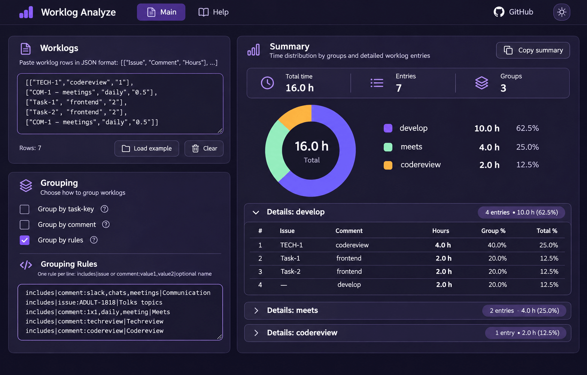
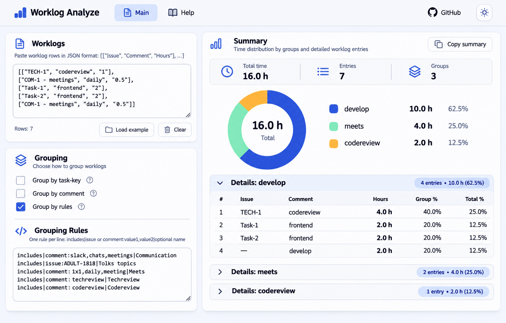

# Worklog Analyze

[worklog-analyze.apilab.ru](https://worklog-analyze.apilab.ru/)

Worklog Analyze is a browser-based tool for importing, grouping, and summarizing Jira worklog data. It shows how recorded time is distributed across tasks or custom categories, and lets you inspect the individual entries behind each total.

Mockup:  

## Features

### Import worklogs

- Paste worklog rows into the **Worklogs** text area as a JSON array of rows: `[["Issue", "Comment", "Hours"], ...]`.
- Each row contains an issue key or task name, a comment, and time in hours. The app converts hours to minutes for calculations and displays totals in hours.
- The Help page provides a browser-console script for extracting rows from the Jira work calendar report and copying the transformed rows to the clipboard.
- The Help page also provides a configurable link to the Jira work calendar and an image guide for Jira field configuration. The default Jira domain is `jira.skyeng.tech`.

### Configure grouping

Select any combination of these options:

- **Group by task-key** combines entries with the same issue.
- **Group by comment** combines entries with the same normalized comment (trimmed and lowercased).
- **Group by rules** assigns matching entries to custom categories.

When several grouping options are selected, the resulting grouping key combines the selected issue, comment, and matching rule. Rule matching checks the first matching rule, in the order entered. If no selected grouping option produces a key, the entry is grouped under `develop`.

Rules use one line per rule in this format:

```text
includes|issue or comment:value1,value2|Optional display name
```

For example:

```text
includes|comment:slack,chats,meetings|Communication
includes|issue:ADULT-1818|Tolks topics
```

The action currently supported is `includes`. Matching is substring-based; comments are lowercased and trimmed before matching, so use lowercase rule values for comments. Issue matching preserves case. The optional display name is used in the chart and results list; a named rule also merges matches into the named group regardless of task/comment grouping. Without a name, the combined grouping key is used.

### View summaries and details

- A doughnut chart and matching legend show each group’s share of total logged time.
- The summary shows the overall total and each category’s hours and percentage.
- Hovering or focusing a legend row highlights the corresponding chart segment. Selecting a row toggles its detail table.
- Expand **Details** for a group to see the contributing worklog entries, sorted by time, with issue, comment, hours, and percentages of both the group and overall total.
- Percentages and hours are rounded for display; the detailed row’s tooltip shows its original duration in minutes.

### Interface and actions

- Light and dark themes follow the mockups in `specs/`; the header toggle saves the selected theme in browser storage.
- The responsive layout places worklog inputs and grouping controls beside the summary on desktop, and stacks them on smaller screens.
- **Load example** restores the sample worklogs, rules, and grouping settings. **Clear** empties the worklogs while preserving the grouping configuration.
- **Copy summary** copies the total, entry and group counts, and each group’s hours and percentage to the clipboard.
- Summary cards show total hours, individual worklog count, and group count. Inline detail tables show each entry’s issue, comment, hours, group percentage, and overall percentage.
- The interface uses the SVG assets in `src/assets/icons`.

### Save and restore your work

The app saves the worklog text, grouping rules, and grouping options in browser `localStorage` under `workLogAnalyzeForm-v2`. Saved values are restored on the next visit to the same browser. Editing any of these controls updates the saved data, and changes trigger recalculation.

### Process data in the browser

Grouping runs in a Web Worker so the main interface remains responsive during larger imports. Worklogs are processed in chunks of 500 entries, and closely spaced updates are debounced. The app does not need a server-side worklog-processing API.

## Pages

- **Main** — worklog input, grouping controls, rules, chart, and per-category details.
- **Help** — Jira import script, Jira calendar link, and configuration guide.

## Development

Run these commands from the monorepo root after installing workspace dependencies:

```sh
npx nx serve worklog-analyze
npx nx build worklog-analyze
npx nx lint worklog-analyze
```

The development server is available at `http://localhost:4200/` by default. The production build is written to `dist/apps/worklog-analyze`.

## Notes

- Worklog text must be valid JSON for the expected array-of-arrays format; malformed input is reported through an on-screen notification.
- Browser storage is local to the browser profile. Clearing site data removes the saved configuration and imported worklogs.
- The initial sample contains example worklogs and grouping rules so the chart can be explored immediately.

## Architecture

The app uses standalone Angular components with OnPush change detection and zoneless bootstrap. Signals own the persisted input state, component inputs, and derived chart values. The controls expose a `model()` binding to the page, so there is one source of truth for the worklogs, rules, and grouping options.

RxJS handles the asynchronous analysis boundary: input changes are debounced by 200 ms, and `switchMap` cancels the previous worker request. The analyzer service reuses one long-lived worker and terminates it when the service is destroyed. Request IDs keep responses associated with the correct subscriber; cancelling a request removes its listeners and stops its pending chunks. Errors are caught within the request so a corrected input can be analyzed without reloading the page. Rendering effects manage Chart.js and release its resources when the chart changes or the page is destroyed.

There is currently no configured unit-test target or application spec suite. Use the app lint target, TypeScript checks for `tsconfig.app.json` and `tsconfig.worker.json`, and the Angular production build to check changes.
